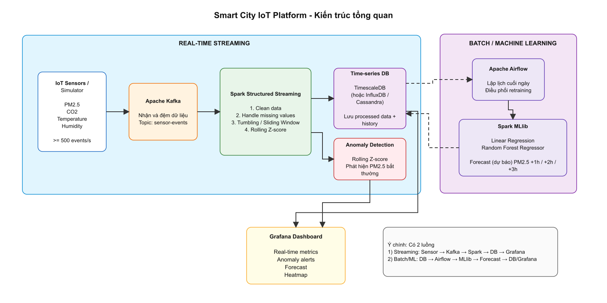

# Smart City IoT Platform for Environmental Forecasting

Đề tài 4 môn cao học Big Data: hệ thống giám sát môi trường và dự báo PM2.5 từ cảm biến IoT. Triển khai nhánh **môi trường** của đề tài, dùng Kafka, Spark, Airflow, TimescaleDB và Grafana.

## Scope tổng thể của đề tài
- Environmental Monitoring
- Dataset: Beijing Multi-Site Air-Quality Data
- Target: PM2.5
- Kafka >= 500 events/s
- Spark Structured Streaming
- Rolling Z-score anomaly detection
- Spark MLlib forecasting
- Apache Airflow orchestration
- TimescaleDB storage
- Grafana visualization
- Docker Compose runtime

## Architecture



[Chỉnh sửa sơ đồ Draw.io](docs/smart_city_bigdata_architecture.drawio) · [Xem bản SVG](docs/smart_city_bigdata_architecture.svg)

Sơ đồ được dựng từ file `smart_city_bigdata_architecture.drawio` trong thư mục cha `tieu-luan/`. Hệ thống có hai luồng xử lý:

- **Streaming:** Producer đọc CSV và mô phỏng sự kiện cảm biến gửi vào Kafka. Spark Structured Streaming chuẩn hóa dữ liệu, tính trung bình PM2.5 theo cửa sổ 5 phút và phát hiện bất thường bằng Rolling Z-score, sau đó ghi vào `sensor_metrics`. Grafana truy vấn TimescaleDB để hiển thị số liệu và bất thường.
- **Batch/ML:** Airflow lập lịch DAG chạy Spark MLlib. Job đọc lịch sử từ `sensor_metrics`, tạo đặc trưng, huấn luyện Linear Regression và Random Forest, đánh giá bằng MAE/RMSE/R², rồi ghi dự báo của mô hình có RMSE thấp nhất vào `pm25_forecast` để Grafana hiển thị.

```text
Dataset -> Producer -> Kafka -> Spark Streaming -> TimescaleDB.sensor_metrics -> Grafana
Airflow -> Spark MLlib (đọc TimescaleDB.sensor_metrics) -> TimescaleDB.pm25_forecast -> Grafana
```

Hình Draw.io là sơ đồ định hướng ban đầu. Bản triển khai hiện dùng TimescaleDB, có dự báo **+1/+2/+3 giờ** và job tổng hợp cuối ngày. Anomaly Detection nằm trong streaming job. Chi tiết trạng thái qua nhiều micro-batch, các bảng dữ liệu và luồng triển khai nằm trong [kiến trúc triển khai](docs/architecture.md).

## Đối chiếu yêu cầu đề tài

Bảng dưới liên hệ yêu cầu đề tài với các thành phần trong mã nguồn.

| Yêu cầu trong `de-tai.md` | Phần triển khai |
| --- | --- |
| Kafka nhận ≥500 events/s | Producer điều tiết tốc độ, 3 partitions, đo số bản tin được broker xác nhận |
| Làm sạch và nội suy | Loại timestamp/trạm không hợp lệ; đổi số âm/NaN/∞ thành null; nội suy tuyến tính có hai đầu mút, khoảng cách tối đa 3 giờ |
| Tumbling/sliding windows | Tumbling 5 phút, sliding 30 phút bước 5 phút trong `sensor_windows` |
| Rolling Z-score | Baseline 30 phút trước từng điểm, tách theo trạm, dùng lịch sử đã lưu qua nhiều batch |
| Cảnh báo | Z-score và ngưỡng PM2.5 cấu hình; dashboard + Grafana-managed alert |
| Tổng hợp cuối ngày | Spark ghi `daily_summary`, Airflow chạy trước job ML |
| Hồi quy phân tán 1–3 giờ | Linear Regression/Random Forest trên Spark, ba horizon, holdout theo thời gian |
| Time-series database | TimescaleDB hypertables; upsert theo khóa nghiệp vụ để chạy lại an toàn |
| Grafana và heatmap | 4 dashboard, lọc theo trạm, heatmap phân bố nồng độ theo thời gian |

500 events/s là mục tiêu đầu vào cần đo trên máy chạy; chưa đồng nghĩa throughput xử lý Spark đạt 500 events/s.

## Cấu trúc thư mục

Các chú thích sau dấu `#` mô tả vai trò của thư mục hoặc file:

```text
smart-city-iot-bigdata-complete/
├── README.md                         # Tổng quan, kiến trúc và hướng dẫn chạy
├── .env.example                      # Mẫu biến môi trường cho Docker Compose
├── docker-compose.yml                # Khai báo dịch vụ, mạng, volume và thứ tự khởi động
├── producer/                         # Mô phỏng dữ liệu cảm biến và gửi vào Kafka
│   ├── sensor_simulator.py           # Đọc CSV Beijing, tạo JSON, điều tiết tốc độ gửi
│   └── requirements.txt              # Thư viện Python cần cho producer
├── spark/
│   ├── common.py                     # JDBC và PostgreSQL upsert dùng chung
│   ├── batch/daily_aggregation.py     # Tổng hợp số liệu theo ngày UTC
│   ├── streaming/                    # Pipeline xử lý dữ liệu thời gian thực
│   │   ├── streaming_job.py          # Điều phối streaming, checkpoint và ghi JDBC
│   │   ├── kafka_consumer.py         # Đọc topic Kafka và giải mã sự kiện JSON
│   │   ├── schemas.py                # Khai báo schema sự kiện cảm biến
│   │   ├── transform.py              # Chuẩn hóa và làm sạch dữ liệu
│   │   └── anomaly_detection.py      # Tính Rolling Z-score và đánh dấu bất thường
│   └── ml/                           # Pipeline huấn luyện và dự báo PM2.5
│       ├── ml_pipeline.py            # Điều phối huấn luyện, chọn mô hình và ghi dự báo
│       ├── extract.py                # Đọc dữ liệu sensor_metrics qua JDBC
│       ├── features.py               # Tạo đặc trưng và nhãn dự báo
│       ├── train_linear_regression.py # Huấn luyện Linear Regression
│       ├── train_random_forest.py    # Huấn luyện Random Forest Regressor
│       └── evaluate.py               # Đánh giá MAE, RMSE và R²
├── airflow/
│   ├── dags/pm25_forecast_pipeline.py # DAG lập lịch chạy job Spark MLlib
│   └── logs/                         # Thư mục có sẵn; runtime dùng named volume airflow-logs
├── database/                         # SQL tạo cấu trúc lưu trữ TimescaleDB
│   ├── init.sql                      # Schema đầy đủ cho database mới
│   ├── migrations/                   # Migration bổ sung cho database đã tồn tại
│   ├── schema_sensor_metrics.sql     # Schema dữ liệu đo và kết quả phát hiện bất thường
│   └── schema_pm25_forecast.sql       # Schema kết quả dự báo PM2.5
├── grafana/
│   ├── dashboards/                   # Dashboard thời gian thực, bất thường và dự báo
│   └── provisioning/                 # Tự động cấu hình datasource và nạp dashboard
├── docker/
│   ├── producer.Dockerfile           # Image chạy producer Python
│   ├── spark.Dockerfile              # Image Spark 3.5.3 và quyền ghi checkpoint
│   └── airflow.Dockerfile            # Image Airflow có Java, PySpark và Spark provider
├── scripts/                          # Lệnh hỗ trợ chạy từ thư mục gốc dự án
│   ├── start.sh                      # Chuẩn bị .env và khởi động các dịch vụ
│   ├── stop.sh                       # Dừng các dịch vụ
│   ├── run-producer.sh               # Chạy producer với dữ liệu CSV
│   ├── run-streaming.sh              # Submit job streaming vào Spark cluster
│   ├── run-ml.sh                     # Submit job ML vào Spark cluster
├── data/
│   ├── raw/beijing-multisite/        # Nơi đặt CSV Beijing trước khi chạy producer
│   ├── sample/sample_events.json     # Ví dụ sự kiện cảm biến theo schema chuẩn
│   └── processed/                    # Thư mục dự phòng cho dữ liệu đã xử lý
├── models/                           # Điểm mount trong container cho volume chứa mô hình
├── tests/test_pipeline.py            # Test thời gian, nội suy, Z-score và chạy lại
├── experiments/                      # Nơi lưu kết quả thí nghiệm của nhóm
│   ├── throughput/                   # Thí nghiệm tốc độ xử lý
│   ├── anomaly/                      # Thí nghiệm phát hiện bất thường
│   └── forecasting/                  # Thí nghiệm dự báo và so sánh mô hình
└── docs/                             # Tài liệu, sơ đồ kiến trúc và hình minh họa
```

Tạo `data/raw/beijing-multisite/` và đặt CSV vào đó nếu dùng dữ liệu thật. Producer ghi kết quả tốc độ vào `experiments/throughput/latest.json`. Mô hình, metrics ML, log Airflow, Kafka, database và checkpoint được lưu trong named volumes; dùng `scripts/export-results.sh` để chép metrics ML ra máy host. `data/processed/` vẫn là thư mục dự phòng.

## Canonical event schema
```json
{
  "event_id": "Aotizhongxin-2016-05-01T10:00:00+08:00",
  "station_id": "Aotizhongxin",
  "timestamp": "2016-05-01T10:00:00+08:00",
  "pm25": 45.2,
  "pm10": 68.1,
  "so2": 8.0,
  "no2": 42.0,
  "co": 620.0,
  "o3": 55.0,
  "temperature": 31.4,
  "pressure": 1008.3,
  "dew_point": 24.2,
  "rainfall": 0.0,
  "wind_direction": "NE",
  "wind_speed": 2.4
}
```
Khóa nghiệp vụ: `(timestamp, station_id)`. `event_id` dùng truy vết; bản tin phải có trạm và timestamp hợp lệ. PM2.5 thiếu được giữ dưới dạng null để nội suy; `NA` không được thay bằng 0. Các trường ô nhiễm dùng đơn vị của nguồn Beijing, PM2.5 là µg/m³. Dataset có **CO**, không phải CO2; chưa có trường độ ẩm tương đối.

## Processed schema
`sensor_metrics` lưu các phép đo cùng `pm25_imputed`, `pm25_avg_5m`, `pm25_rolling_mean_30m`, `pm25_rolling_std_30m`, `pm25_z_score`, `is_anomaly`, `is_threshold_exceeded`. Schema đầy đủ và các bảng `sensor_raw`, `sensor_windows`, `daily_summary`, `pm25_forecast`, `model_evaluations` nằm trong `database/init.sql`.

## ML contract
Dữ liệu được tổng hợp về giờ đã hoàn tất; timestamp của feature là **cuối giờ**, tức thời điểm dữ liệu đã sẵn sàng. Nhãn tại `t+h` là trung bình PM2.5 của giờ kết thúc tại `t+h`, với `h ∈ {1,2,3}`. Lag/label được nối bằng timestamp chính xác theo trạm, không dùng số thứ tự dòng để suy ra số giờ.

Feature gồm PM2.5, lag 1/2/3 giờ, giờ trong ngày và ngày trong tuần. Bỏ các giá trị PM2.5 nội suy hai chiều khỏi dữ liệu ML để tránh dùng thông tin tương lai. Chia khoảng 80/20 theo thời gian; nhãn của tập train phải kết thúc trước holdout. Chọn LR/RF theo RMSE, ghi MAE/RMSE/R², refit trên toàn bộ lịch sử đủ nhãn rồi dự báo từ feature mới nhất của từng trạm. Mô hình lưu theo thời điểm chạy trong volume `spark-models`.

## Team ownership

| Thành viên | Phạm vi chính | Trách nhiệm |
| --- | --- | --- |
| Member 1 | `producer/`, `spark/streaming/` | Thu thập/mô phỏng cảm biến, Kafka producer, làm sạch/nội suy, window và anomaly streaming |
| Member 2 | `spark/ml/`, `spark/batch/`, `airflow/`, `grafana/` | Tổng hợp ngày, huấn luyện/dự báo, điều phối DAG, dashboard/heatmap |
| Shared | `database/`, `docker/`, `docker-compose.yml`, `scripts/`, `README.md`, `docs/` | Môi trường chạy, schema/giao tiếp giữa hai thành viên, hướng dẫn tích hợp |

## Khởi động môi trường Docker

Cần Docker Desktop đang chạy. Stack hiện cấu hình một Spark worker 3 GB, cùng Kafka, database, Airflow và Grafana; nên dành khoảng 8 GB RAM cho Docker. Build lần đầu cần truy cập Docker Hub, PyPI và Maven Central.

```bash
cd /Users/khangtna/mydata/PTIT/master/hk1/big-data/tieu-luan/smart-city-iot-bigdata-complete
./scripts/start.sh
```

Script tạo `.env` từ `.env.example` nếu chưa có, build image, khởi động danh sách công cụ nền tảng và chờ healthcheck tối đa 240 giây. Script tự chọn `docker compose` hoặc `docker-compose`. Có thể dùng trực tiếp:

```bash
docker-compose up -d --build
docker-compose ps -a
```

Lệnh Compose mặc định chỉ khởi động dịch vụ nền tảng. Toàn bộ service `streaming`, `producer`, `tests` và các tham số thuật toán chưa dùng được comment trong `docker-compose.yml`. Để dùng các script nghiệp vụ, bỏ comment service/tham số liên quan và bật profile tương ứng (`pipeline` hoặc `manual`).

| Thành phần | Link / địa chỉ từ máy host | Công dụng / đăng nhập |
| --- | --- | --- |
| Kafka | `localhost:9092` | Kết nối Kafka client; không có giao diện web |
| TimescaleDB | `localhost:5432` | Kết nối DBeaver/psql; cấu hình trong `.env` |
| Spark master | http://localhost:8080 | Giao diện quản lý cluster |
| Spark worker | http://localhost:8081 | Giao diện worker |
| Spark RPC | `localhost:7077` | Cổng nhận job; không phải giao diện web |
| Airflow | http://localhost:8088 | Quản trị DAG; mặc định `admin/admin` |
| Grafana | http://localhost:3000 | Dashboard; mặc định `admin/admin` |

Airflow scheduler và database metadata của Airflow chỉ dùng trong mạng Docker, không có port truy cập riêng từ máy host.

Trong Grafana, datasource **TimescaleDB** được cấu hình từ biến môi trường và folder **Smart City** có dashboard giám sát, cảnh báo, dự báo, heatmap. Dashboard có thể hiển thị **No data** khi chưa nạp dữ liệu; đây là trạng thái bình thường khi database chưa có bản ghi phù hợp.

Trong Airflow, DAG `pm25_forecast_pipeline` được nạp ở trạng thái **Paused**. `airflow-init` cũng đưa DAG đã tồn tại trong database về Paused khi khởi tạo stack. Bật DAG khi muốn chạy lịch nghiệp vụ; tạm dừng DAG không tự hủy task đang chạy.

Ba service `kafka-init`, `database-migrate`, `airflow-init` là tác vụ khởi tạo một lần: **Exited (0)** là thành công, không phải lỗi. Tham khảo [hướng dẫn kiểm tra môi trường](docs/report/validation.md).

### Xem log vận hành

```bash
docker-compose ps -a
docker-compose logs --tail 100 airflow-init airflow-webserver airflow-scheduler
docker-compose logs --tail 100 spark-master spark-worker grafana
```

### Cấu hình và dữ liệu lưu bền

- `.env`: tài khoản/database, mật khẩu Grafana, tài nguyên Spark; xem `.env.example`.
- Kafka nội bộ dùng `kafka:29092`; client chạy trên máy host dùng `localhost:9092`.
- Spark/Airflow cùng Python 3.10 và Spark 3.5.3. JDBC/Kafka JAR được đóng gói vào image khi build.
- TimescaleDB chạy `init.sql` khi tạo volume mới; `database-migrate` bổ sung schema cho volume đã tồn tại.
- Named volumes lưu dữ liệu Kafka/database/Grafana, log Airflow và checkpoint/model/results Spark. Các volume và dữ liệu từ lần chạy trước được giữ lại.
- Nếu Docker tải thư viện bị timeout dù host có mạng, kiểm tra proxy/mạng Docker Desktop; có thể truyền proxy hợp lệ qua `docker-compose build --build-arg HTTPS_PROXY=...`.

### Dừng nền tảng

```bash
./scripts/stop.sh
```

Lệnh dừng container và giữ named volumes để lần sau tiếp tục sử dụng.
