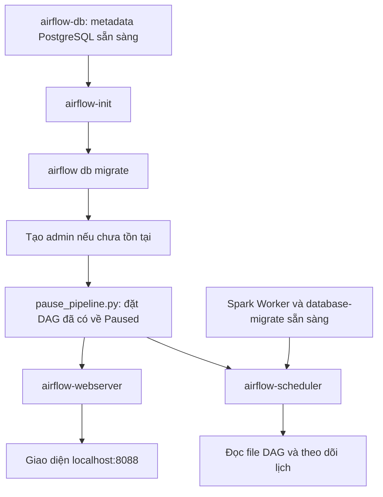
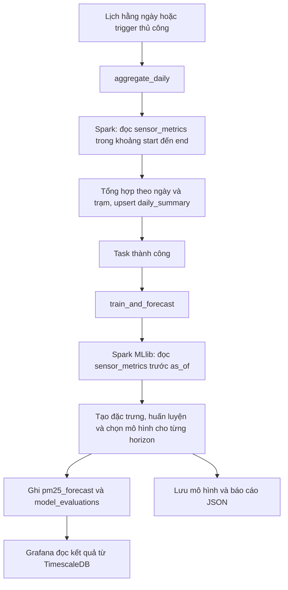

# Airflow — điều phối tổng hợp ngày và dự báo PM2.5

Airflow lập lịch và theo dõi hai job Spark: tổng hợp dữ liệu theo ngày, sau đó huấn luyện và dự báo PM2.5 trước 1–3 giờ. Airflow điều phối tác vụ; Spark thực hiện tính toán và ghi kết quả vào TimescaleDB.

## Cấu trúc và chức năng từng file

```text
airflow/
├── dags/
│   └── pm25_forecast_pipeline.py  # Định nghĩa lịch, task và thứ tự chạy
├── pause_pipeline.py             # Đặt DAG đã tồn tại về Paused lúc khởi tạo
├── logs/
│   └── .gitkeep                  # Giữ thư mục trong Git
└── README.md                     # Tài liệu cấu trúc và workflow
```

| File | Chức năng |
|---|---|
| [dags/pm25_forecast_pipeline.py](dags/pm25_forecast_pipeline.py) | Khai báo DAG `pm25_forecast_pipeline` và hai `SparkSubmitOperator`; không chạy job ngay khi import file. |
| [pause_pipeline.py](pause_pipeline.py) | Được `airflow-init` gọi để đặt DAG đã có trong metadata về Paused. Nếu DAG chưa tồn tại, script không tạo DAG; DAG mới có cấu hình Paused riêng. |
| `logs/.gitkeep` | File giữ chỗ, không phải code. Compose hiện lưu log thực tế trong named volume `airflow-logs`, không mount thư mục này. |

Các file liên quan ngoài thư mục Airflow:

| File | Chức năng |
|---|---|
| [../docker-compose.yml](../docker-compose.yml) | Khai báo service, dependency, biến môi trường, connection Spark và volume. |
| [../docker/airflow.Dockerfile](../docker/airflow.Dockerfile) | Build image Airflow có Java, PySpark, Spark provider và thư viện kết nối database. |
| [../docker/fetch_jars.py](../docker/fetch_jars.py) | Chuẩn bị JDBC driver cho Spark đọc TimescaleDB. |
| [../spark/batch/daily_aggregation.py](../spark/batch/daily_aggregation.py) | Tổng hợp dữ liệu cảm biến theo ngày/trạm và upsert vào `daily_summary`. |
| [../spark/ml/ml_pipeline.py](../spark/ml/ml_pipeline.py) | Huấn luyện, đánh giá, chọn mô hình và ghi dự báo; xem [README ML](../spark/ml/README.md). |
| [../spark/common.py](../spark/common.py) | Đọc TimescaleDB qua JDBC và ghi PostgreSQL bằng psycopg2. |

## Workflow khởi tạo



- `airflow-db` lưu trạng thái DAG/task và tài khoản, độc lập với TimescaleDB lưu dữ liệu nghiệp vụ.
- `airflow-init` dùng image chung với webserver và scheduler. Lệnh `build airflow-init` chỉ build image, không thực thi bước init.
- `airflow-webserver` cung cấp giao diện; `airflow-scheduler` điều phối task với `LocalExecutor`.
- DAG mới được tạo ở trạng thái Paused. Mỗi lần thực thi lại bước init, script cũng đặt DAG đã có về Paused.
- Paused ngăn lịch tự tạo lượt chạy mới; không phải lệnh hủy các task đang chạy và không ngăn người dùng trigger thủ công.

## Workflow của một lần chạy DAG



Dòng `aggregate >> forecast` quy định task tổng hợp phải thành công trước task ML. Hai job đều đọc `sensor_metrics`; job ML **không lấy `daily_summary` làm dữ liệu huấn luyện**. Mũi tên giữa hai task là quan hệ thứ tự chạy, không phải truyền DataFrame qua Airflow.

### Task `aggregate_daily`

Gọi `spark/batch/daily_aggregation.py` với:

```text
--start {{ data_interval_start.isoformat() }}
--end   {{ data_interval_end.isoformat() }}
```

Airflow thay biểu thức Jinja bằng mốc thời gian của khoảng dữ liệu của lần chạy. Job lọc `timestamp >= start` và `timestamp < end`, rồi tổng hợp theo ngày/trạm: số bản ghi, số PM2.5 hợp lệ, trung bình, cực đại và số cảnh báo. Kết quả upsert theo khóa `(day, station_id)`.

### Task `train_and_forecast`

Gọi `spark/ml/ml_pipeline.py` với:

```text
--as-of {{ data_interval_end.isoformat() }}
```

Job ML dùng dữ liệu lịch sử trước mốc `as_of`, không chỉ dữ liệu trong một ngày của task tổng hợp. Nó đánh giá Linear Regression và Random Forest, chọn theo RMSE cho từng horizon 1/2/3 giờ, fit lại mô hình thắng rồi lưu dự báo.

## Lịch chạy và retry

| Cấu hình trong DAG | Ý nghĩa |
|---|---|
| `start_date=datetime(2026, 1, 1)` | Mốc bắt đầu xét lịch; không có nghĩa là chạy ngay khi khởi động. |
| `schedule="@daily"` | Lịch theo ngày; lượt chạy định kỳ xử lý khoảng ngày vừa kết thúc. |
| `catchup=False` | Không tự tạo toàn bộ các lượt chạy lịch sử bị bỏ lỡ. |
| `max_active_runs=1` | Tối đa một DAG run hoạt động cùng lúc. |
| `is_paused_upon_creation=True` | DAG mới ở trạng thái Paused. |
| `retries=1` | Mỗi task được thử lại một lần sau lần chạy đầu thất bại. |
| `retry_delay=2 phút` | Thời gian chờ trước lần thử lại. |

`start_date` hiện không gắn múi giờ tường minh nên dùng timezone mặc định của Airflow; với cấu hình mặc định là UTC. Hai job Spark cũng thiết lập UTC. Ngày tổng hợp vì vậy được hiểu theo UTC, không phải ngày lịch Việt Nam.

Nếu task tổng hợp vẫn lỗi sau retry, task ML không được chạy theo dependency mặc định. Có thể xem trạng thái và log của từng task trong giao diện Airflow.

## Kết nối Spark và TimescaleDB

Compose truyền connection Spark bằng biến môi trường:

```yaml
AIRFLOW_CONN_SPARK_DEFAULT: '{"conn_type":"spark","host":"spark://spark-master","port":7077}'
```

DAG dùng `conn_id="spark_default"` và `deploy_mode="client"`:

- Driver của job chạy trong môi trường task tại container `airflow-scheduler`.
- Spark Worker chạy executor thực hiện tính toán phân tán.
- `spark.driver.host=airflow-scheduler` cho executor địa chỉ kết nối về driver.
- `spark.driver.bindAddress=0.0.0.0` cho driver lắng nghe trên các interface của container.
- `spark.cores.max=2` giới hạn số core của ứng dụng trên cluster; `spark.sql.shuffle.partitions=3` cấu hình partition khi shuffle.

Kết nối TimescaleDB được các job lấy từ `JDBC_URL`, `POSTGRES_USER`, `POSTGRES_PASSWORD` qua `spark/common.py`. DAG không khai báo một Airflow connection riêng cho TimescaleDB. Kafka không được hai task này sử dụng trực tiếp.

## Volume dùng chung

| Đường dẫn trong container | Nguồn | Vai trò |
|---|---|---|
| `/opt/airflow/dags` | `./airflow/dags`, chỉ đọc | Airflow đọc định nghĩa DAG. |
| `/opt/project` | Thư mục repo | Chứa các script Spark được submit. |
| `/opt/airflow/logs` | `airflow-logs` | Lưu log task. |
| `/opt/project/models` | `spark-models` | Lưu mô hình, dùng chung với Spark. |
| `/opt/project/experiments/forecasting` | `spark-results` | Lưu báo cáo đánh giá, dùng chung với Spark. |

Sửa DAG hoặc script được bind mount không cần build lại image. Thay đổi dependency trong Dockerfile cần build lại image và tái tạo container sử dụng image mới.

## Khởi động và kiểm tra nền tảng

Chạy tại thư mục gốc repo:

```bash
# Cần khi chưa có image hoặc đã thay đổi dependency của image.
docker-compose build airflow-init

# Khởi động Airflow và các service phụ thuộc.
docker-compose up -d --wait --wait-timeout 240 \
  airflow-webserver airflow-scheduler

# Kiểm tra container và định nghĩa DAG; chưa thực thi job nghiệp vụ.
docker-compose ps -a
docker-compose exec airflow-scheduler airflow dags list
docker-compose exec airflow-scheduler airflow dags list-import-errors
docker-compose exec airflow-scheduler airflow tasks list pm25_forecast_pipeline
```

Giao diện: [http://localhost:8088](http://localhost:8088). Tài khoản mới được init tạo là `admin` / `admin`; tài khoản đã tồn tại được giữ nguyên. `airflow-init` ở trạng thái `Exited (0)` nghĩa là init thành công.

Khi chỉ kiểm tra công cụ, giữ DAG Paused và không trigger. Kiểm tra cú pháp/import DAG xác nhận định nghĩa được nạp, chưa xác nhận job Spark hay pipeline dữ liệu chạy thành công.

```bash
# Xem lỗi khởi tạo hoặc vận hành.
docker-compose logs --tail 100 \
  airflow-init airflow-webserver airflow-scheduler
```
