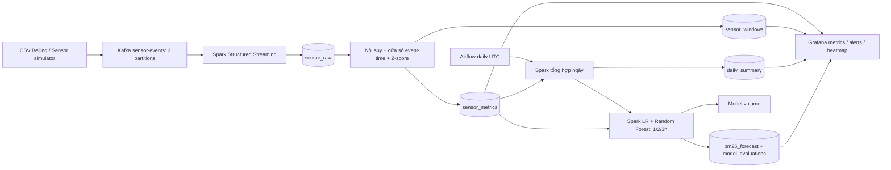

# Kiến trúc triển khai

## Streaming và trạng thái qua batch

Kafka là nguồn replay. Spark đọc JSON bằng schema cố định, làm sạch trạm/thời gian và chuyển số không hợp lệ thành null. `foreachBatch` ghi `sensor_raw` theo khóa `(timestamp,station_id)`, sau đó đọc lại vùng lịch sử liên quan từ TimescaleDB. Spark partition theo trạm để nội suy tuyến tính và tính cửa sổ, nên kết quả không phụ thuộc biên chia micro-batch.

Nội suy chỉ khi có hai điểm hợp lệ bao quanh và khoảng cách <= `INTERPOLATION_MAX_GAP_SECONDS`. Điểm mới/đến muộn có thể thay đổi nội suy tối đa ±gap và baseline 30 phút kế tiếp. Job đọc thêm context trước/sau vùng ảnh hưởng, rồi upsert lại metrics và cửa sổ 5/30 phút. Không bỏ điểm đến muộn theo watermark; thời gian event được lưu bền trong raw hypertable. Một batch phủ khoảng lịch sử quá rộng sẽ tốn chi phí đọc và tính lại: producer merge theo timestamp và `MAX_OFFSETS_PER_TRIGGER` giới hạn đầu vào.

Baseline của điểm tại t gồm điểm cùng trạm trong [t−30 phút,t), không chứa chính điểm t. `z=(x−mean)/std`; không tính z khi thiếu số mẫu hoặc std=0. Cờ ngưỡng tuyệt đối hoạt động độc lập. Đầu ra cuối cùng converges khi replay; nhiều bảng/partition không commit nguyên tử cùng lúc.

## ML và thời gian dự báo

Hourly aggregation dùng khoảng [t−1h,t), timestamp cuối giờ t. Chỉ giờ hoàn tất được đưa vào mô hình; lags được join đúng t−1h/t−2h/t−3h. Nhãn h là PM2.5 trung bình giờ kết thúc tại t+h. Giá trị nội suy hai chiều được loại khỏi ML để tránh nhìn trước tương lai.

Train/test được chia theo thời gian trên toàn bộ trạm. Điều kiện label_time của train <= cutoff ngăn nhãn train tràn vào giai đoạn test. Đánh giá LR và RF trên cùng holdout bằng MAE/RMSE/R², chọn RMSE thấp hơn; fit lại lịch sử đã có nhãn, dự báo từ bản ghi feature mới nhất của từng trạm. Không ghi prediction của tập test làm dự báo vận hành.

## Vận hành

- Spark driver streaming có hostname riêng; Airflow driver chạy client mode ở `airflow-scheduler`, executor chạy trên worker. Cùng Python 3.10, Spark 3.5.3, Scala 2.12.
- Mã nguồn dùng đường dẫn `/opt/project` trên cả driver và executor; `PYTHONPATH` cho phép import module chung. Checkpoint/model/results dùng named volume.
- Kafka nội bộ dùng `kafka:29092`, client trên host dùng `localhost:9092`.
- JDBC URL và tài khoản được lấy từ cấu hình Compose, Grafana dùng cùng biến môi trường.
- Migration phải thành công trước streaming/Grafana. DAG tổng hợp ngày phải thành công trước huấn luyện.
- Quy tắc Grafana được provision trong Alerting; chưa cấu hình điểm nhận thông báo bên ngoài.

## Tài liệu nền

- [Spark Structured Streaming: foreachBatch và cơ chế replay](https://spark.apache.org/docs/3.5.3/structured-streaming-programming-guide.html)
- [Airflow Spark operator](https://airflow.apache.org/docs/apache-airflow-providers-apache-spark/4.11.3/operators.html)
- [Grafana Heatmap](https://grafana.com/docs/grafana/latest/visualizations/panels-visualizations/visualizations/heatmap/)
