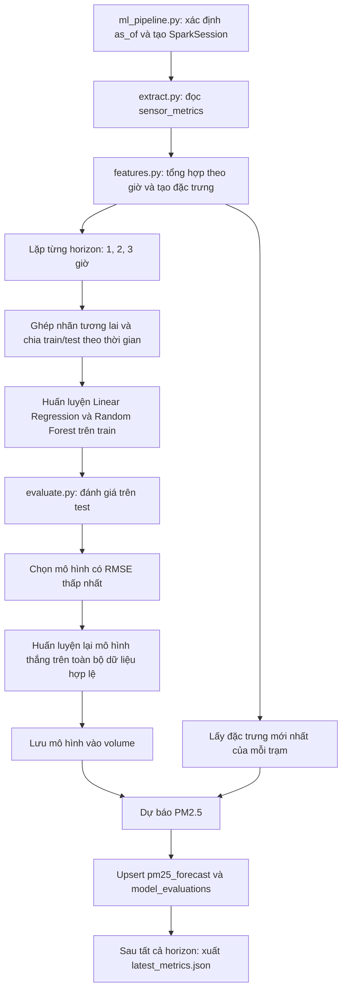

# Dự báo PM2.5 bằng Spark MLlib

Module đọc dữ liệu cảm biến đã xử lý từ TimescaleDB, huấn luyện Linear Regression và Random Forest, chọn mô hình theo RMSE và dự báo PM2.5 cho từng trạm trước 1–3 giờ. Điểm bắt đầu của chương trình là `main()` trong `ml_pipeline.py`.

## Cấu trúc và chức năng

| File | Chức năng |
|---|---|
| [ml_pipeline.py](ml_pipeline.py) | Điều phối đọc dữ liệu, tạo đặc trưng, huấn luyện, đánh giá, chọn mô hình, dự báo và lưu kết quả. |
| [extract.py](extract.py) | Đọc bảng `sensor_metrics`; chỉ lấy bản ghi có `timestamp < as_of` nếu truyền mốc thời gian. |
| [features.py](features.py) | Tổng hợp theo giờ, tạo độ trễ, ghép nhãn tương lai, chia train/test theo thời gian và lấy đầu vào mới nhất của mỗi trạm. |
| [train_linear_regression.py](train_linear_regression.py) | Fit pipeline gồm Imputer → VectorAssembler → LinearRegression; trả về mô hình đã huấn luyện. |
| [train_random_forest.py](train_random_forest.py) | Fit pipeline gồm Imputer → VectorAssembler → RandomForestRegressor, dùng 50 cây và seed 42. |
| [evaluate.py](evaluate.py) | So sánh `prediction` với `label`, trả về MAE, RMSE và R². |

Module dùng thêm [../common.py](../common.py): đọc database qua JDBC, kết nối PostgreSQL và upsert dự báo trên các executor. File dùng chung này nằm ngoài thư mục `ml/`.

## Workflow



### 1. Đọc và giới hạn dữ liệu

`--as-of` nhận thời gian ISO, nên có múi giờ, ví dụ `2026-10-21T10:00:00Z`. Nếu bỏ qua, chương trình dùng thời gian UTC hiện tại. Mốc này giới hạn lịch sử được dùng và được lưu vào `created_at` của dự báo.

Đầu vào là `sensor_metrics`, cần có `timestamp`, `station_id`, `pm25`. Nếu có cột `pm25_imputed`, các bản ghi được đánh dấu đã nội suy bị loại để tránh dữ liệu tương lai trong phép nội suy ảnh hưởng kết quả đánh giá.

### 2. Tạo đặc trưng — `build_feature_frame()`

Dữ liệu được gom theo trạm và cửa sổ một giờ, lấy trung bình PM2.5. `timestamp` của dòng tổng hợp là **thời điểm kết thúc cửa sổ**; chỉ giữ các cửa sổ đã kết thúc tại mốc cho phép.

| Đặc trưng | Ý nghĩa |
|---|---|
| `pm25` | PM2.5 trung bình của cửa sổ giờ vừa kết thúc |
| `pm25_lag_1`, `pm25_lag_2`, `pm25_lag_3` | PM2.5 tại các mốc lùi đúng 1, 2, 3 giờ |
| `hour_of_day` | Giờ trong ngày theo UTC của phiên Spark |
| `day_of_week` | Thứ trong tuần theo quy ước Spark: Chủ nhật = 1, thứ Bảy = 7 |

Độ trễ được ghép theo thời gian chính xác, không lấy đơn thuần dòng đứng trước, vì dữ liệu có thể thiếu giờ. Các dòng chưa đủ đặc trưng bị loại.

### 3. Tạo nhãn và chia tập dữ liệu

`build_training_frame()` ghép đặc trưng tại thời điểm `t` với PM2.5 tại `t + horizon_hours`, đặt tên giá trị cần dự báo là `label`.

Ví dụ: dòng đặc trưng ở 10:00 với horizon 2 giờ có nhãn là PM2.5 của cửa sổ kết thúc lúc 12:00.

`temporal_split()` lấy mốc phân vị 80% trên các thời điểm đầu vào phân biệt:

- Train: thời điểm của nhãn `label_time <= cutoff`.
- Test: thời điểm đầu vào `timestamp > cutoff`.

Cách này giữ nhãn train không vượt sang giai đoạn đánh giá. Số dòng train/test không nhất thiết đúng tỷ lệ 80/20 vì còn khoảng cách giữa thời điểm đầu vào và nhãn.

Code yêu cầu ít nhất 50 dòng sau khi ghép nhãn cho mỗi horizon, ít nhất 30 dòng train và 10 dòng test. Thông báo lỗi khuyến nghị nạp ít nhất 7 ngày dữ liệu; số dòng hợp lệ mới là điều kiện thực tế được kiểm tra.

### 4. Huấn luyện và chọn mô hình

Cả hai thuật toán sử dụng cùng cấu trúc pipeline:

```text
Các cột đặc trưng
    → Imputer: điền giá trị thiếu bằng trung bình học từ dữ liệu fit
    → VectorAssembler: gom đặc trưng thành vector features
    → Thuật toán hồi quy: học label, xuất prediction
```

Bước tạo đặc trưng hiện đã loại dòng thiếu, nhưng Imputer vẫn nằm trong pipeline mô hình. Khi đánh giá, chỉ fit trên train rồi transform test.

`evaluate()` trả về MAE, RMSE và R². Pipeline chọn mô hình có RMSE thấp nhất cho từng horizon, sau đó fit lại mô hình thắng trên toàn bộ dữ liệu có nhãn của horizon đó. Điểm đánh giá được lưu là điểm trên tập test trước khi fit lại, không phải điểm của mô hình đã fit trên toàn bộ dữ liệu.

Mỗi horizon dùng một mô hình chung học từ dữ liệu các trạm; code không huấn luyện một mô hình riêng cho từng trạm.

### 5. Dự báo và lưu kết quả

`latest_features()` lấy dòng đặc trưng mới nhất của từng trạm. Mô hình thắng tạo dự báo và giới hạn giá trị nhỏ nhất về 0.

`forecast_time` được tính bằng **mốc đặc trưng mới nhất của trạm + horizon**, không phải luôn bằng `created_at + horizon`. Khi dữ liệu đầu vào cũ, thời điểm dự báo cũng có thể đã qua so với thời điểm chạy.

| Đầu ra | Nội dung |
|---|---|
| `pm25_forecast` | Dự báo của mô hình thắng cho từng trạm và horizon; upsert theo khóa `(created_at, forecast_time, station_id, model_name)`. |
| `model_evaluations` | Điểm của cả hai mô hình theo lần chạy/horizon; `selected` đánh dấu mô hình thắng. |
| `/opt/project/models/pm25_<horizon>h_<run_time>` | Mô hình Spark đã lưu, nằm trong volume `spark-models` của Compose. |
| `/opt/project/experiments/forecasting/latest_metrics.json` | Báo cáo các horizon, điểm đánh giá, mô hình được chọn và đường dẫn mô hình; nằm trong volume `spark-results`. |

Báo cáo JSON chỉ được ghi sau khi xử lý xong tất cả horizon. Các lần ghi mô hình và database diễn ra theo từng horizon, nên lỗi giữa chừng có thể để lại kết quả của horizon đã hoàn thành; toàn bộ lần chạy không phải một transaction chung.

## Liên hệ với các công cụ khác

- **TimescaleDB:** cung cấp dữ liệu đầu vào và lưu dự báo/đánh giá; schema được chuẩn bị trong `database/`.
- **Spark Master/Worker:** cung cấp tài nguyên thực thi; chỉ khởi động cluster chưa tự chạy `ml_pipeline.py`.
- **Airflow:** có thể gọi job này theo lịch; việc lập lịch nằm ngoài module ML.
- **Grafana:** đọc kết quả từ database, chẳng hạn view `latest_forecasts`; không trực tiếp đọc mô hình Spark.

## Cấu hình liên quan

| Tham số | Vai trò |
|---|---|
| `--as-of` | Giới hạn thời gian dữ liệu đầu vào; mặc định là thời điểm hiện tại UTC. |
| `FORECAST_HORIZONS` | Danh sách horizon, mặc định `1,2,3`; code chỉ chấp nhận các giá trị 1, 2, 3. |
| `JDBC_URL` | Địa chỉ database cho phần đọc dữ liệu, được cấu hình trong Compose. |
| `POSTGRES_USER`, `POSTGRES_PASSWORD` | Tài khoản database. |
| `PYTHONPATH` | Cho phép import module trong `spark/` và `spark/ml/`; Compose đã cấu hình. |

Để review, đọc theo thứ tự: `ml_pipeline.py` → `extract.py` → `features.py` → hai file `train_*.py` → `evaluate.py` → `spark/common.py`.
